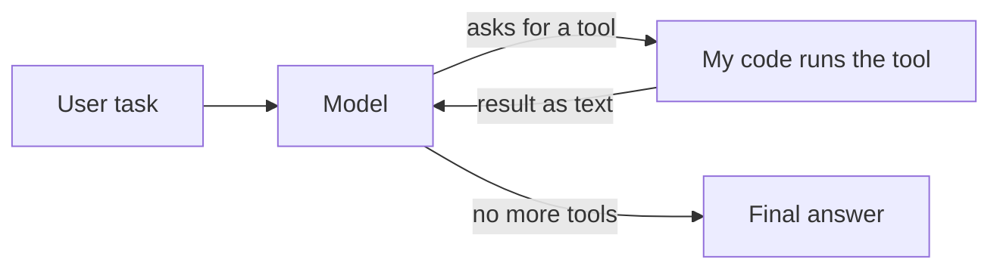
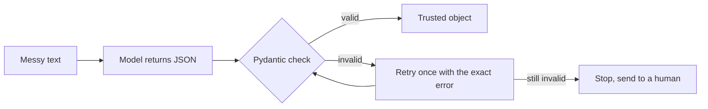
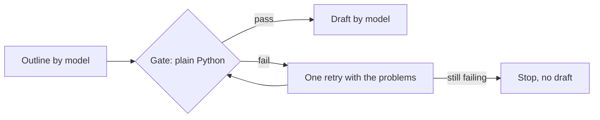
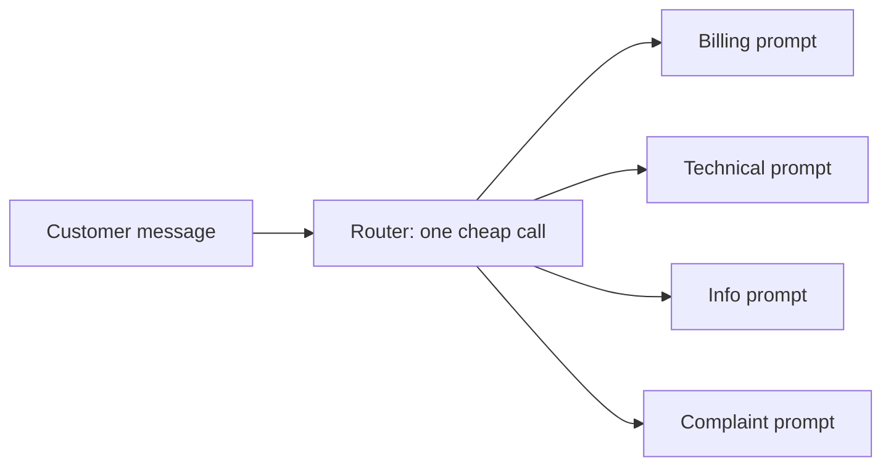
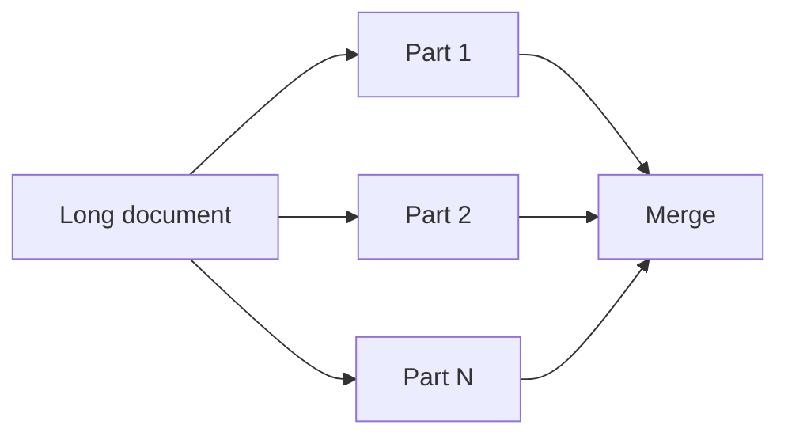
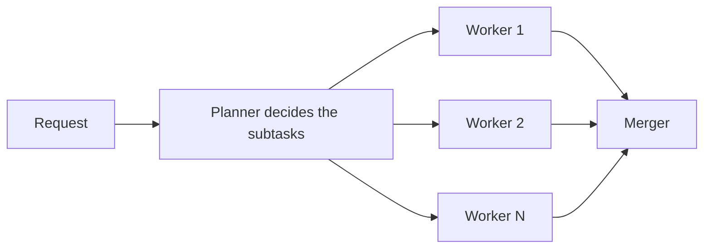
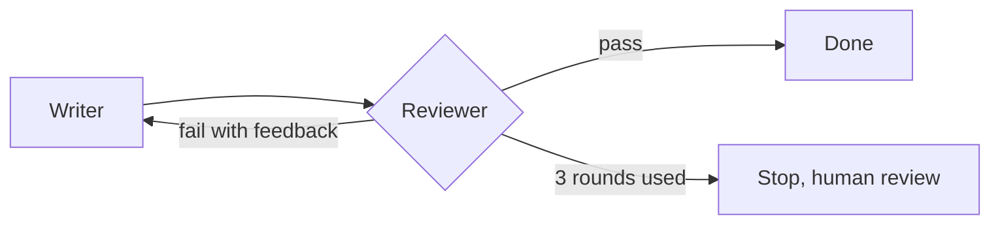
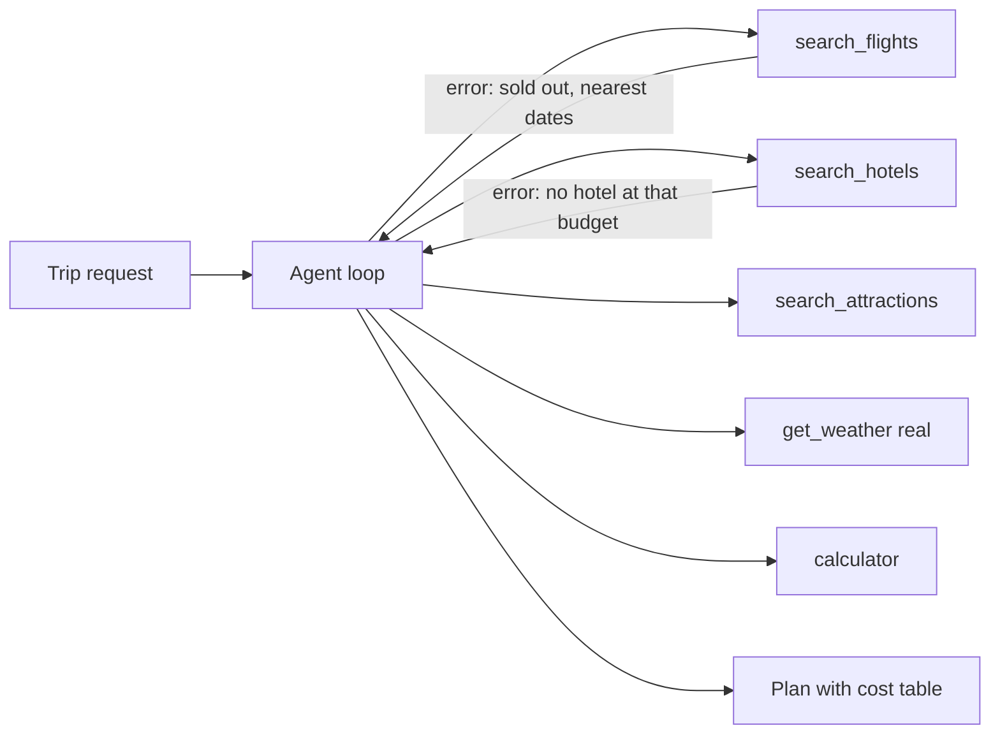

# Week 1: Agents from scratch (no framework)

I built a tool-calling agent, five workflow patterns and a small travel planner in plain Python,
to see exactly what happens inside an agent. No LangChain this week.

- **Model:** `openai/gpt-4o-mini` through OpenRouter
- **Measured from day 1:** every model call writes tokens, latency and cost to `logs/calls.jsonl`
- **Example business:** Surat Silks, a small online saree shop (all data is mock)

Numbers marked **TODO** are not filled in yet. Each one names the command that produces it.
I only report numbers I have actually measured.

## Results at a glance

| Pattern | What I measured | Result |
|---|---|---|
| Agent loop | Latency and cost of one small call | about 0.7-1.5 s and about $0.00004 per call (Day 2 log) |
| Structured output | Extractor accuracy on 10 messy invoices | 9/10, then 10/10 after one prompt rule; 3/3 on 3 fresh cases |
| Streaming | Time to first token | 1.69 s, against 2.24 s total |
| Prompt chaining | Gate result and retries | **TODO** (`python chaining.py strict`) |
| Routing | Accuracy on 30 hand-labelled messages | **TODO** (`python routing.py`) |
| Parallelisation | Sectioning speed-up | 8.52 s one by one, 2.06 s in parallel (4.1x), same cost |
| Voting | Unanimous vs split votes | **TODO** (`python parallel.py voting`) |
| Orchestrator-workers | Calls, time, cost per kit | **TODO** (`python orchestrator.py`) |
| Evaluator-optimizer | Rounds needed to pass | **TODO** (`python evaluator_optimizer.py hard`) |
| Workflow vs agent | Same task, 3 runs each | workflow 3/3 correct, agent 0/3 (see below) |
| Travel planner | Cost and time per plan | **TODO** (`python travel_planner.py` and the other presets) |

---

## 1. Tool-calling agent loop



The model never runs a tool. It only asks, and my code runs it and sends the result back. The loop repeats
until the model stops asking, with a hard `max_steps` limit. Tool errors go back to the model as text
so it can recover.

- **Use it when:** the steps cannot be known in advance.
- **Do not use it when:** the steps are fixed. A workflow is cheaper and more predictable.
- **Observed:** one small call takes about 0.7-1.5 s and costs about $0.00004. Input tokens grow with every
  step, because the whole history is sent again.
- **A bug worth remembering:** my tool handling was indented outside the `for` loop. The agent asked for the
  same tool 8 times and never saw a result. The log made it obvious.

## 2. Structured output with validation and one retry



- **Use it when:** program code consumes the model's output (invoices, tickets, records).
- **Do not use it when:** a human reads the text and exact structure does not matter.
- **Observed:** 9/10 on the first run. The one miss returned `invoice_number: null` for a bill that had
  "ref no PH/2026/334". It passed validation (null is allowed), so no retry happened. Only my answer key
  caught it. One prompt rule fixed it: 10/10, and 3/3 on fresh cases.
- **Lesson:** validation checks shape and rules, not truth. A retry can also push a model to invent a value
  just to satisfy a rule.

## 3. Streaming

The answer arrives in small chunks. Tool calls arrive in fragments: the `id` and `name` come once, and the
`arguments` come in pieces that must be joined by `index`. They can only be parsed after the stream ends.

- **Use it when:** a person is watching the answer appear.
- **Do not use it when:** the output is only consumed by code.
- **Observed:** first token after 1.69 s, whole answer after 2.24 s (66 tokens, 68 chunks). Streaming saves
  waiting time before the first word, not total time.

## 4. Prompt chaining with a gate



- **Use it when:** a task has steps in a fixed order and a bad middle result would waste the next step.
- **Do not use it when:** one well-written prompt already gives good output.
- **Observed:** **TODO.** Run `python chaining.py strict` and note the gate attempts and the number of calls.

## 5. Routing



- **Use it when:** inputs differ a lot and each kind needs its own handling.
- **Do not use it when:** one prompt handles every case well, or the categories overlap so much that even
  humans disagree.
- **Observed:** **TODO.** Accuracy on 30 hand-labelled messages: `__ / 30`. Mistakes and which categories
  were confused: `__`.

## 6. Parallelisation: sectioning and voting



Voting runs the same question 3 times and takes the majority. A split vote means the case is borderline.

- **Use it when:** the parts are independent (sectioning), or one answer is unreliable (voting).
- **Do not use it when:** each step needs the previous result, or when the API rate limit is tight.
- **Observed:** 6 summaries took 8.52 s one by one and 2.06 s in parallel: 4.1x faster, at the same cost.
  Parallelism buys time, not money. Voting: **TODO.**
- **A bug worth remembering:** calling `asyncio.run()` twice crashed with "Event loop is closed". The async
  client keeps connections tied to the first loop. One `asyncio.run` per program.

## 7. Orchestrator-workers



The model decides the split at runtime. A plain-Python gate checks the plan. If one worker fails, the rest
still finish and the result says what is missing.

- **Use it when:** the subtasks cannot be known in advance.
- **Do not use it when:** the split is always the same (use sectioning), or the subtasks depend on each other.
- **Observed:** **TODO.** Planner subtasks: `__`; calls: `__`; time: `__ s`; cost: `$__`.

## 8. Evaluator-optimizer



The reviewer runs plain-Python checks first (word count), then an AI judge with a rubric. The loop is capped
at 3 rounds.

- **Use it when:** quality standards are clear and feedback really improves the result.
- **Do not use it when:** there is no clear standard, or the first draft is usually good enough.
- **Observed:** **TODO.** Rounds needed in normal mode: `__`; in hard mode: `__`.

## 9. Workflow vs agent (same task, 3 runs each)

Task: add up my monthly expenses and give the rent percentage. Truth: total 23,500, rent 51.06%.

| | Correct | LLM calls | Cost | Time |
|---|---|---|---|---|
| Fixed workflow | 3/3 | 2 | $0.000064 | 3.4 s |
| Agent | 0/3 | 1 | $0.000046 | 0.9 s |

The agent looked cheaper and faster only because it never did the job. In all 3 runs it replied "please
provide a keyword to search for" and made no tool call. The workflow succeeded because my code already
knew to search for "Expense".

- **Caveat:** the checker only tests the numbers. The workflow's answer also wrote "$", but my notes have no
  currency, so the model invented the unit.
- **Lesson:** when the steps are known in advance, a workflow is the safer choice. An agent needs a prompt
  that tells it to act, and it earns its extra cost only when the steps cannot be known.

## 10. Mini-project: Travel Planner without LangChain



Five tools: weather (real, Open-Meteo), calculator, and three mock tools that read `mock_data/*.json`.
The mock tools fail in useful ways (sold-out dates, no airport, no hotel under budget, a flaky 503). Their
errors say what is possible, so the agent re-plans instead of giving up.

| Preset | What it tests |
|---|---|
| `default` | Sold-out dates both ways, so the dates must change |
| `tight` | A small budget, so only the cheapest hotel fits |
| `impossible` | A budget too small, so the agent must say so honestly |
| `manali` | No airport, so the agent must say what its tools do not cover |
| `default flaky` | The first hotel search fails with a 503, so the agent must retry |

- **Use it when:** the task has real options, constraints and things that can go wrong.
- **Do not use it when:** a fixed workflow could do the job.
- **Observed:** **TODO.** Per preset: LLM calls `__`, cost `$__`, time `__ s`, and whether the plan stayed
  within budget and was honest about what changed.

---

## Honest limits

- Small samples (3 runs, 10 to 30 cases), and the model is not fully deterministic.
- An AI judge can be wrong. Week 8 is about checking judges.
- All flights, hotels and attractions are fictional, so the planner proves the loop, not real travel advice.

## Run it

```bash
python agent.py                 # Day 2: the loop with its tools
python test_extractor.py        # Day 3: extractor score
python routing.py               # Day 4: router accuracy
python compare.py               # Day 5: workflow vs agent
python travel_planner.py        # Day 6: the planner
python cost_report.py           # totals and the latency graph
```